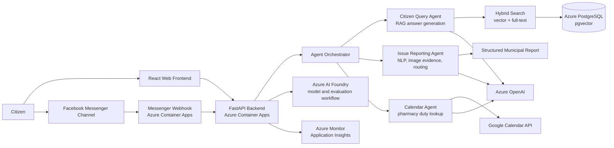

# Greek Municipality AI Assistant

Greek Municipality AI Assistant is a cloud-native, multi-agent RAG platform for Greek local government. It helps citizens ask natural-language questions, find municipal information, report local issues, and receive structured guidance through a web interface or Facebook Messenger.

## Architecture

## Tech Stack

- Azure Container Apps
- Azure OpenAI
- Azure AI Foundry
- Azure PostgreSQL with pgvector
- React
- FastAPI
- Meta API
- Hybrid vector and full-text search

## Features

- **Citizen query resolution:** answers municipality-specific questions through a Greek-language conversational interface.
- **Issue reporting with NLP and image input:** converts free-form reports and supporting evidence into actionable municipal cases.
- **Structured report generation and routing:** extracts category, location, contact details, and report content, then routes issues to the relevant municipal department.
- **Google Calendar integration:** supports time-sensitive public-service information such as pharmacy duty schedules.
- **Hybrid search:** combines semantic vector retrieval with PostgreSQL full-text search for stronger grounding over municipal documents.
- **Multi-channel access:** supports both a web interface and Facebook Messenger webhook integration.
- **Cloud-native deployment:** runs on Azure Container Apps with managed Azure infrastructure, monitoring, and scalable service boundaries.

## How It Works

The platform ingests municipal documents and operational records into PostgreSQL, where each item is stored with searchable text and vector embeddings. When a citizen asks a question, the backend performs hybrid retrieval by combining full-text search with pgvector similarity search. The retrieved context is passed to Azure OpenAI so the answer remains grounded in municipality-specific data.

An orchestration layer selects the right agent for the user intent. The query agent handles general information requests, the issue-reporting agent collects missing fields and produces a structured report, and the calendar agent retrieves date-sensitive information from Google Calendar. The same orchestration model can serve both the React frontend and the Messenger channel.

For issue reporting, the assistant identifies the likely municipal category, validates required fields, asks follow-up questions when data is missing, and generates a confirmation-ready report before routing. This reduces manual triage while keeping the citizen in control before submission.

## Commercial Status

The source code is private due to ongoing commercial negotiations.
